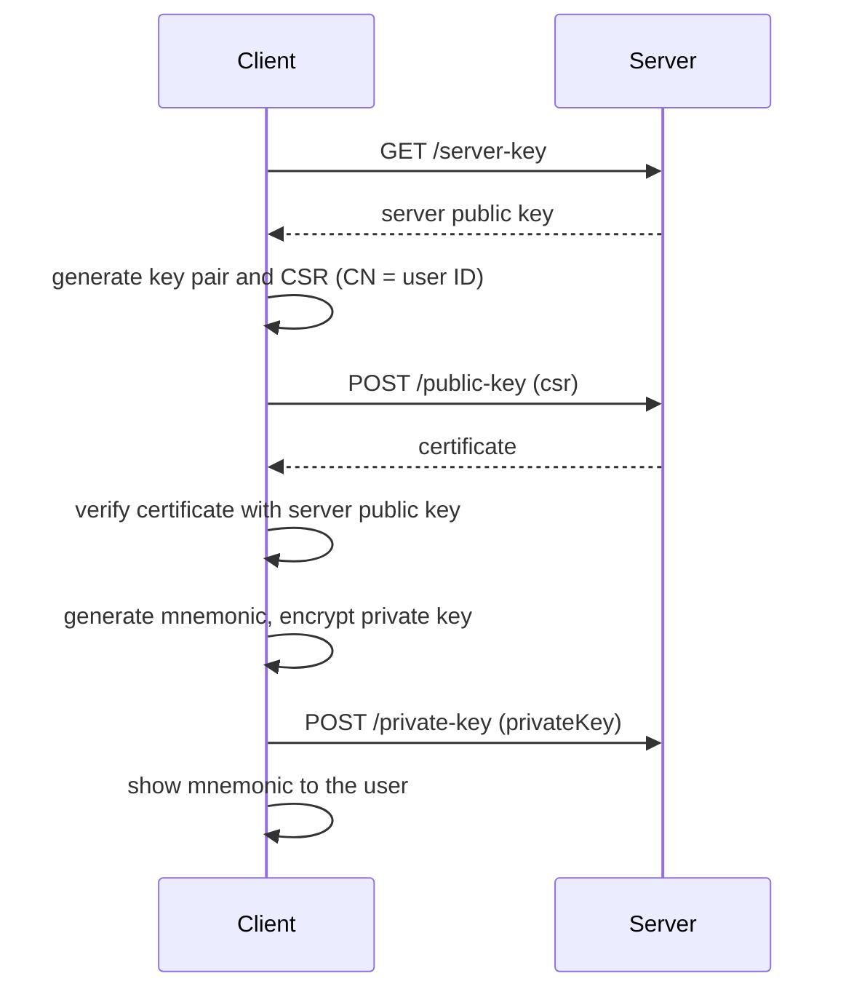
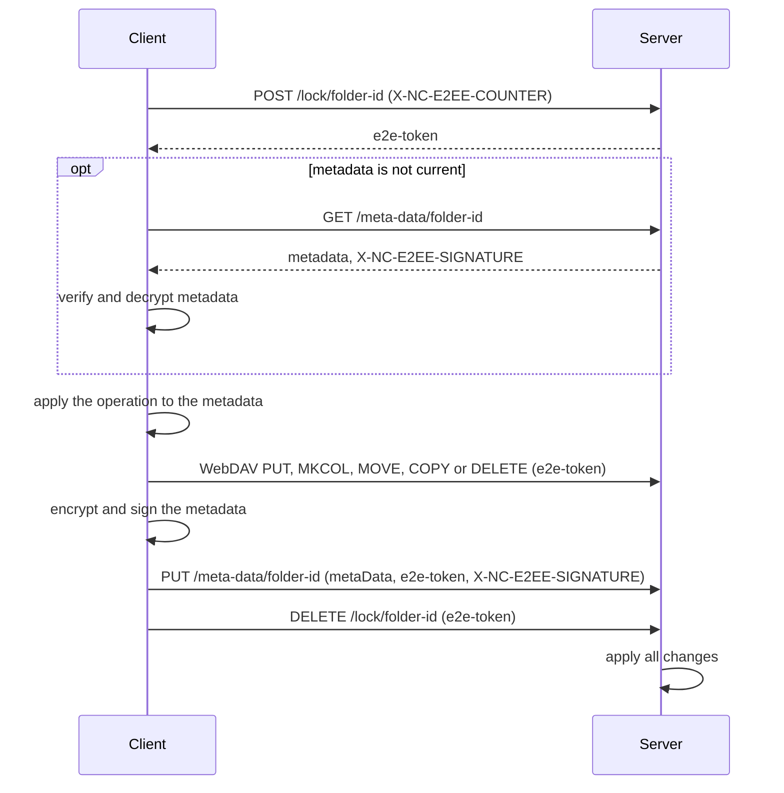
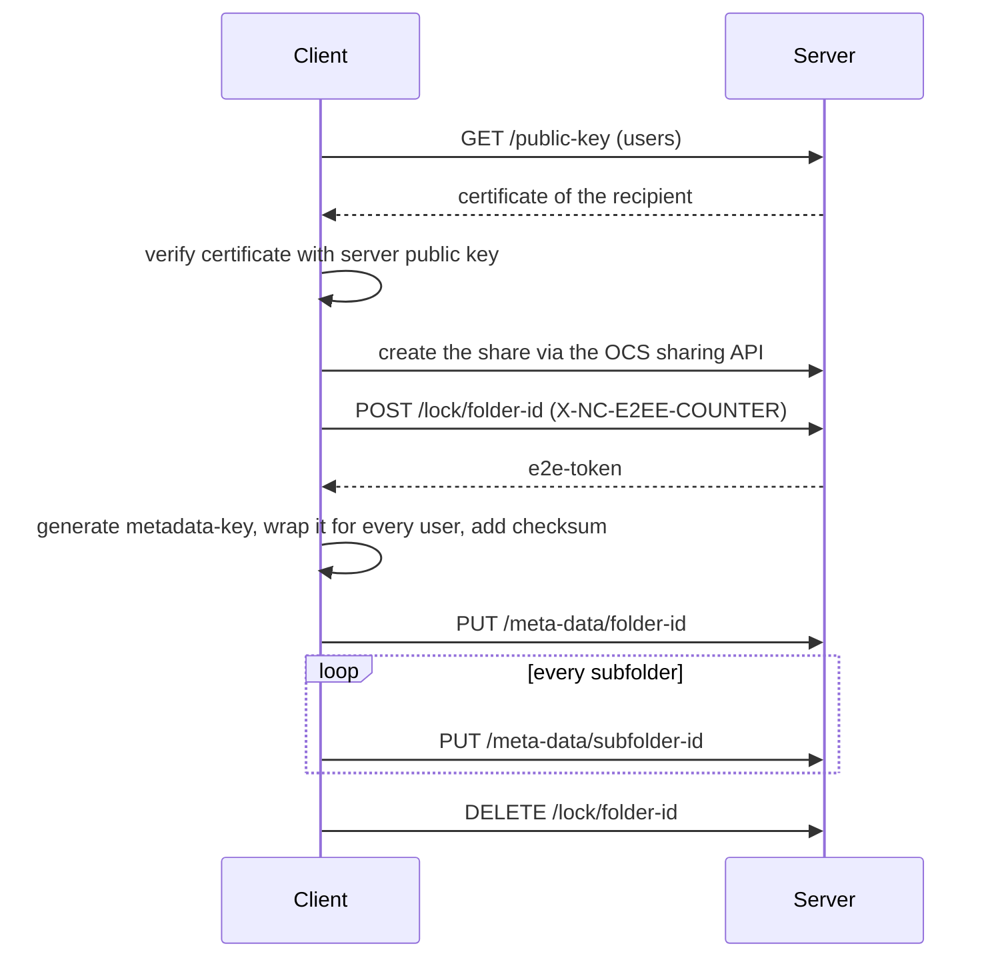

# Nextcloud end-to-end encryption

## Abstract
This document specifies the end-to-end encryption protocol used by Nextcloud clients.
It defines how clients manage key material, how the content and the metadata of end-to-end encrypted folders are encrypted, signed and stored on a Nextcloud server,
and how encrypted folders are shared with other users and with users without a Nextcloud account.

## Status of this document
This document specifies version 2.1 of the Nextcloud end-to-end encryption protocol, using the metadata versions `"2.0"` and `"2.1"`.
It is the authoritative implementation guideline for Nextcloud clients.

The previous version of this protocol is specified in [RFC_v1.md](./RFC_v1.md).
The change history is listed in the [README](./README.md#history).

We would like to invite you to scrutinize our source code and cryptographic approach.
We are looking forward to your input to refine our approach towards client-side encryption.
In addition, we will also make sure to validate our approach on time by external cryptographic experts.

## Table of contents

* [Abstract](#abstract)
* [Status of this document](#status-of-this-document)
* [Introduction](#introduction)
  * [Design goals](#design-goals)
  * [Scope](#scope)
* [Conventions and terminology](#conventions-and-terminology)
  * [Requirements language](#requirements-language)
  * [Terminology](#terminology)
  * [Encoding](#encoding)
* [Architecture overview](#architecture-overview)
  * [Trust model](#trust-model)
  * [Key hierarchy](#key-hierarchy)
  * [Folder structure](#folder-structure)
* [Threat model and security goals](#threat-model-and-security-goals)
  * [Attacker model](#attacker-model)
  * [Security goals](#security-goals)
* [Data formats](#data-formats)
  * [Metadata file](#metadata-file)
  * [Encrypted payload](#encrypted-payload)
  * [User](#user)
  * [Metadata](#metadata)
  * [File entry](#file-entry)
  * [Filedrop entry](#filedrop-entry)
  * [Random identifiers](#random-identifiers)
  * [Encrypted private key](#encrypted-private-key)
  * [Initial metadata](#initial-metadata)
* [Cryptographic operations](#cryptographic-operations)
  * [Cryptographic parameters](#cryptographic-parameters)
  * [Encrypting data](#encrypting-data)
  * [Encrypting the metadata](#encrypting-the-metadata)
  * [Signing the metadata](#signing-the-metadata)
  * [Verifying the metadata](#verifying-the-metadata)
* [Protocol procedures](#protocol-procedures)
  * [User key lifecycle](#user-key-lifecycle)
  * [Folder lifecycle](#folder-lifecycle)
  * [Membership](#membership)
* [HTTP API](#http-api)
  * [General requirements](#general-requirements)
  * [Endpoint overview](#endpoint-overview)
  * [Key endpoints](#key-endpoints)
  * [Encryption endpoints](#encryption-endpoints)
  * [Lock endpoints](#lock-endpoints)
  * [Metadata endpoints](#metadata-endpoints)
  * [WebDAV](#webdav)
* [Security considerations](#security-considerations)
  * [Accepted risks](#accepted-risks)
  * [Attack scenarios](#attack-scenarios)
  * [Handling of complete key material loss](#handling-of-complete-key-material-loss)
* [Versioning and backward compatibility](#versioning-and-backward-compatibility)
* [Appendix: Examples](#appendix-examples)
* [Appendix: Possible extensions](#appendix-possible-extensions)

## Introduction
Existing client-side encryption solutions often prevent the sharing of encrypted files or the usage on multiple devices.
The Nextcloud end-to-end encryption is designed to allow both, while the server, which stores the encrypted data, is not able to access the content.

The encryption is based upon an asymmetric cryptographic system.
Every user owns a key pair, the certificate of the public key is issued by the Nextcloud server.
Content and metadata of encrypted folders are encrypted with symmetric keys, which are encrypted for every user with access to the folder.

### Design goals
_This section is informative._

The end-to-end encryption has to fulfill the following business and technical criteria.

#### Usage of widely available and tested libraries for crypto primitives
We believe that for security-sensitive functionalities relying on existing and proven libraries is an essential requirement.
Thus we require that:

* The used library for cryptographic primitives is in use widely.
* The used library for cryptographic primitives has undergone successful security audits.

Also due to our wide range of supported systems, the library has to be available for all currently supported versions of the following environments:

* iOS
* Android
* macOS
* Windows
* commonly used Linux distributions
* Web browsers (e.g. using the Web Crypto API)
* PHP

While we do not have any current plans to add support for potential server-side decryption we want to keep this possibility open for the future.

#### Sharing functionality
The Nextcloud end-to-end encryption has to offer support for the following sharing scenarios:

* Sharing encrypted folders with other users
* Any user that is part of the shared folder is able to add new users to the share
* Sharing encrypted folders with users without a Nextcloud account using public shares

#### Optional central data recovery
While end-to-end encryption is meant to prevent access to data for other parties the reality is: People may lose their encryption keys.

While in a home user environment this might be acceptable, in an enterprise this can have grave implications.
Thus an optional central data recovery has to be available offering the following capabilities:

* Central recovery key per instance can be generated
* Central recovery key is not stored on the instance and can be safely exported (e.g. to be stored in a physical vault)
* All data will also be encrypted with the central recovery key when enabled
* Users are prominently warned in the UI of their clients if a central data recovery key is enabled
* When a central data recovery key is enabled the existing end-to-end encrypted folders are not affected

#### Simple multi-device management
Access to encrypted data should easily be possible from any device the end-user owns, this includes all mobile devices as well as desktop devices.

Thus:
* Sharing keys between existing devices has to be frictionless
* Newly added devices should have access to all previously encrypted data

#### Simple authenticated key exchange
Key exchange is a key problem of any cryptographic system.
On one hand one wants to ensure that the key of the participating parties is authentic.
On the other hand, manual comparison of key material is cumbersome and rarely something that regular users can be bothered to do.

A secure and yet simple system has to implement the following properties:
* Key exchange between parties should be frictionless
* Optionally, clients can offer key verification by comparing certificate fingerprints (e.g. by using QR-Codes)

#### Support for HSM
To fulfill enterprise security requirements it should be possible that key material is generated by a hardware security module.
Thus offering strong authentication, tampering resistance and a complete audit trail.

#### Versioning
The protocol has to support versioning in case of future changes in the metadata or cryptographic parameters.

### Scope
_This section is informative._

The following sharing scenarios are out of scope:

* Sharing single files or folders from an encrypted folder
* Sharing encrypted folders with whole groups
* Sharing subfolders of encrypted folders, it is only possible to share the topmost encrypted folder

Since the data is not accessible to the server and to simplify the implementation, losing the following features is accepted:

* Server-side trash bin
* Server-side versioning
* Server-side search
* Server-side previews
* Sharing to groups
* Sharing at the level of individual files
* Sharing of subfolders of an encrypted folder
* Scanning with files_antivirus. Metadata are also ignored by files_antivirus, even though they could be scanned, it adds too much latency.
* Integrity of filedrop entries, see [Accepted risks](#accepted-risks)

## Conventions and terminology

### Requirements language
The key words "MUST", "MUST NOT", "REQUIRED", "SHALL", "SHALL NOT", "SHOULD", "SHOULD NOT", "RECOMMENDED", "NOT RECOMMENDED", "MAY", and "OPTIONAL" in this document are to be interpreted as described in BCP 14 ([RFC 2119](https://www.rfc-editor.org/rfc/rfc2119), [RFC 8174](https://www.rfc-editor.org/rfc/rfc8174)) when, and only when, they appear in all capitals, as shown here.

Sections marked as informative do not contain requirements.

### Terminology
* client: an application implementing this protocol, e.g. the desktop, mobile or web client.
* device: anything able to run one of our supported clients.
* server: the Nextcloud server with the `end_to_end_encryption` app enabled.
* topmost encrypted folder: an encrypted folder whose parent folder is not encrypted.
* subfolder: an encrypted folder inside of a topmost encrypted folder.
* random identifier: the name of an encrypted file or subfolder on the server, used instead of its cleartext name.
* file-metadata: cleartext name, mimetype, file-key, nonce/iv and authTag of a file
* file-key: the actual key used to encrypt the file
* folders-array: associative array mapping random identifiers to folder names
* files-array: associative array mapping random identifiers to the metadata of the file
* users-array: array of information of users. Used to list all users of a shared and encrypted folder, with their certificate and the encrypted metadata-key
* metadata-key: key used to encrypt the metadata of the folder
* filedrop-key: key used to encrypt a single entry of the filedrop array
* metadata: metadata of all files (file-metadata) and sub-folders in the encrypted folder, list of checksums of metadata-keys and a counter
* counter: a number in the metadata that is increased with every change of the metadata
* lock token: a token issued by the server when locking an encrypted folder, required for all modifications of the folder
* share user: the pseudo user representing the recipients of a public share

### Encoding
* Base64: the Base64 encoding with the standard alphabet and padding according to [RFC 4648, Section 4](https://www.rfc-editor.org/rfc/rfc4648#section-4).
* Hex: the lowercase hexadecimal encoding of binary data.
* PEM: Textual encoding of certificate and key structures according to [RFC 7468](https://datatracker.ietf.org/doc/html/rfc7468).
* Keys are always encoded in their raw binary form before being encrypted, wrapped or hashed, never in their Base64 representation.

## Architecture overview
_This section is informative._

### Trust model
As a PKI approach for encryption is used, every certificate is issued by a central root authority.
By default, the Nextcloud server acts as a root authority and issues the certificates from certificate signing requests (CSR) of the clients.
Alternatively, an external certificate authority may be used with certificates being generated and their lifetime tracked outside of the `end_to_end_encryption` Nextcloud app.
That would be the case if certificates (and their associated key-pair) are stored on dedicated USB tokens.

The server is trusted when requesting the server certificate, when adding a new device of a user, and when a certificate of another user is downloaded for the first time (trust on first use, TOFU).

### Key hierarchy
* Every user owns an RSA key pair. The certificate is stored on the server, the private key is stored on the server encrypted with a key derived from a mnemonic only known to the user.
* Every topmost encrypted folder has a metadata-key, which is encrypted with the public key of every user with access to the folder.
  All subfolders of a topmost encrypted folder share its metadata-key.
* Every file has its own file-key, which is stored in the encrypted metadata of its folder.
* Every filedrop entry has its own filedrop-key, which is encrypted with the public key of every user with access to the folder.

### Folder structure
Data access to encrypted folders happens via the regular WebDAV API.
On the server, encrypted files and subfolders are stored using random identifiers as names.
Every encrypted folder has a metadata file, which maps the random identifiers to the cleartext names and contains the file-keys of the files.

## Threat model and security goals

### Attacker model
The end-to-end encryption MUST protect against an attacker with the following capabilities:

* Attacker can circumvent underlying TLS/SSL transport encryption
* Attacker has full control over the server (e.g. compromised server or malicious admin)
* Attacker cannot tamper with key exchange between clients and with initial connection of a new client to a share (Trust on first use (TOFU))
  * Future support for separate trusted key server could avoid the TOFU compromise and therefore protect against a stronger attacker.
* Removed users: A user who is part of a shared end-to-end encrypted folder is trusted until the user has been removed

### Security goals
The protocol MUST achieve the following goals when assuming an attacker as specified above.

* Access to ciphertext MUST NOT leak file content nor file names nor the names of subfolders.
  The accepted risks are listed in [Accepted risks](#accepted-risks).
* Once a user has been removed from an encrypted folder they SHOULD have no relevant key material to decrypt files updated or created in the future.
* **Confidentiality**: No one, except the legitimate recipients, has access to the encrypted documents.
* **Integrity**: Even with writable access to the ciphertext one is not able to tamper with the data unnoticed.
* **Authentication**: All valid changes (uploading new files, changing existing files, removing existing files) to an end-to-end encrypted folder are only made by a user who is part of the (shared) folder.
  Malicious changes are detected at the latest when the client that made the most recent valid change synchronizes the next time.

## Data formats
This section defines all data structures exchanged with the server.
All structures are JSON objects, a complete example is given in [Appendix: Examples](#appendix-examples).

### Metadata file
Every encrypted folder MUST have a metadata file.
The metadata file is a JSON object with the following keys:

| Key | Type | Required | Description |
|-----|------|----------|-------------|
| `metadata` | [Encrypted payload](#encrypted-payload) | yes | The encrypted [metadata](#metadata) of the folder. |
| `users` | array of [User](#user) | topmost encrypted folder only | All users with access to the folder, including the owner. MUST be present for topmost encrypted folders and MUST NOT be present for subfolders. |
| `filedrop` | object mapping [random identifiers](#random-identifiers) to [Filedrop entries](#filedrop-entry) | no | Files added via secure file drop, which have not been migrated yet, see [Ingesting filedrop entries](#ingesting-filedrop-entries). |
| `version` | string | yes | The metadata version, see [Versioning and backward compatibility](#versioning-and-backward-compatibility). |

In case the central data recovery key is enabled the metadata MUST also be encrypted towards the server's central data recovery key.
Clients MUST show a prominent warning to the users for such scenarios.

### Encrypted payload
An encrypted payload holds data encrypted as described in [Encrypting data](#encrypting-data).

| Key | Type | Required | Description |
|-----|------|----------|-------------|
| `ciphertext` | string | yes | Base64 encoded ciphertext, with the authenticationTag appended. |
| `nonce` | string | yes | Base64 encoded nonce. |
| `authenticationTag` | string | yes | Base64 encoded authenticationTag. |

### User
| Key | Type | Required | Description |
|-----|------|----------|-------------|
| `userId` | string | yes | The user ID, or `s:SHARE_TOKEN` for a [share user](#sharing-with-external-users). |
| `certificate` | string | yes | The PEM encoded X.509 certificate of the user. |
| `encryptedMetadataKey` | string | yes | The metadata-key, wrapped with the public key of the user (see [Cryptographic parameters](#cryptographic-parameters)), Base64 encoded. |

### Metadata
The metadata is the plaintext of the `metadata` key of the [metadata file](#metadata-file).

| Key | Type | Required | Description |
|-----|------|----------|-------------|
| `keyChecksums` | array of strings | yes | The Hex encoded SHA-256 hashes of all metadata-keys of the folder. This builds up a history of metadata-keys, entries MUST NOT be removed. |
| `deleted` | boolean | yes | `true` if the topmost encrypted folder was deleted. |
| `counter` | integer | yes | Increased with every change of the metadata. |
| `folders` | object mapping [random identifiers](#random-identifiers) to strings | yes | The cleartext names of the subfolders. |
| `files` | object mapping [random identifiers](#random-identifiers) to [File entries](#file-entry) | yes | The file-metadata of the files. |

### File entry
A file entry holds the file-metadata of a file.

| Key | Type | Required | Description |
|-----|------|----------|-------------|
| `filename` | string | yes | The cleartext name of the file. |
| `mimetype` | string | yes | The mimetype of the file. If unknown, `application/octet-stream` MUST be used. |
| `key` | string | yes | The Base64 encoded file-key. |
| `nonce` | string | yes | The Base64 encoded nonce used to encrypt the file. |
| `authenticationTag` | string | yes | The Base64 encoded authenticationTag of the encrypted file. |

### Filedrop entry
A filedrop entry is an [encrypted payload](#encrypted-payload), encrypted with its own filedrop-key, with an additional key:

| Key | Type | Required | Description |
|-----|------|----------|-------------|
| `users` | array of objects | yes | All users with access to the folder. Every object contains the `userId` and the `encryptedFiledropKey`, the filedrop-key wrapped with the public key of the user (see [Cryptographic parameters](#cryptographic-parameters)), Base64 encoded. |

The plaintext of a filedrop entry is a [file entry](#file-entry).

### Random identifiers
Random identifiers of files and folders MUST follow `/^[0-9a-fA-F]{32}$/`.
They SHOULD be created by generating a random UUID and removing the dashes (`-`).

### Encrypted private key
The private key of a user is stored on the server as a string of three Base64 encoded parts, separated by `|`:

```
{base64(encrypted private key + authenticationTag)}|{base64(nonce)}|{base64(salt)}
```

The private key is encrypted as described in [Cryptographic parameters](#cryptographic-parameters).
The plaintext is the Base64 encoded PEM encoding of the [PKCS#8 (RFC 5208)](https://tools.ietf.org/html/rfc5208#section-5) private key.

### Initial metadata
When creating a new folder, the client MUST create an initial metadata file with the following values:
- the counter starts with 0
- if the folder is a topmost encrypted folder
  - a new metadata-key MUST be generated
  - the users array MUST contain the current user with userId, certificate and encrypted metadata-key
- if the folder is a subfolder of an encrypted folder
  - the metadata-key of the topmost encrypted folder MUST be used, all subfolders share the metadata-key of their topmost encrypted folder
  - the users array MUST NOT be included

## Cryptographic operations

### Cryptographic parameters
Clients MUST use the following algorithms and parameters:

| Purpose | Algorithm | Key | Nonce | Authentication tag |
|---------|-----------|-----|-------|--------------------|
| File content | AES-GCM (`AES/GCM/NoPadding`) | 128 bit file-key | 96 bit | 128 bit |
| Metadata | AES-GCM (`AES/GCM/NoPadding`) | 128 bit metadata-key | 96 bit | 128 bit |
| Filedrop entry | AES-GCM (`AES/GCM/NoPadding`) | 128 bit filedrop-key | 96 bit | 128 bit |
| Private key | AES-GCM (`AES/GCM/NoPadding`) | 256 bit, derived from the mnemonic | 96 bit | 128 bit |
| Wrapping metadata-keys and filedrop-keys | RSA-OAEP with SHA-256 and MGF1 (`RSA/ECB/OAEPWithSHA-256AndMGF1Padding`) | RSA key pair of the user | - | - |
| Metadata signature | CMS signed data, RSASSA-PKCS1-v1_5 with SHA-256 | RSA key pair of the user | - | - |
| Key checksums | SHA-256 | - | - | - |

The key to encrypt the private key MUST be derived from the mnemonic:

| Parameter | Value |
|-----------|-------|
| Mnemonic | 12 words from the English [BIP-0039](https://github.com/bitcoin/bips/blob/master/bip-0039/english.txt) word list, the word list contains 2048 words, thus resulting in 2048^12 possible combinations |
| Input | the mnemonic, lowercase and without any whitespace |
| KDF | PBKDF2 with HMAC-SHA256 |
| Iterations | 600000 |
| Salt | 40 randomly generated bytes |

Private keys created with an older version of this protocol use different parameters, see [Legacy private key encryption](#legacy-private-key-encryption).

### Encrypting data
For every encryption with AES-GCM a new random nonce MUST be generated.
A file-key or filedrop-key MUST NOT be used for more than one file, to prevent having the same key and nonce for two different files.

The encrypted data consists of the ciphertext with the authenticationTag appended.
Where the [data formats](#data-formats) provide a separate `authenticationTag`, it MUST contain the same authenticationTag.

### Encrypting the metadata
To encrypt the [metadata](#metadata) or the plaintext of a [filedrop entry](#filedrop-entry), the client MUST:
1. Stringify the JSON document
2. Compress it using gzip
3. Encrypt it as described in [Encrypting data](#encrypting-data), using the binary metadata-key or filedrop-key
4. Base64 encode the result and store it as [encrypted payload](#encrypted-payload)

Decrypting is done in the reverse order.

### Signing the metadata
Every metadata file MUST be signed by the user who created or changed it.
The signature is a Cryptographic Message Syntax (CMS) signed data structure, according to [RFC 5652](https://datatracker.ietf.org/doc/html/rfc5652):
- It MUST be created using the certificate of the user.
- The signed data MUST be prepared from the [metadata file](#metadata-file) as follows:
   1. Remove the `filedrop` key
   2. Stringify the JSON without spaces and newlines (except in keys or values), with object keys sorted alphabetically
   3. Encode the JSON string with Base64
- The SignerIdentifier of the CMS container MUST identify the userId of the user who created the signature.
- It MUST include the signed attributes described in [RFC 6488](https://www.rfc-editor.org/rfc/rfc6488.html).
- It MUST be generated in detached mode, the metadata is not included in the signature as it is already stored on the server and is always retrieved with a `GET` request.

The encoded binary CMS structure is Base64 encoded and sent as the `X-NC-E2EE-SIGNATURE` HTTP header when [creating](#create-metadata) or [updating](#update-metadata) the metadata.

### Verifying the metadata
Before using a metadata file, e.g. on a folder refresh, the client MUST verify its signature.
The signature is returned when [getting the metadata](#get-metadata).

To verify the signature the client MUST:
1. Prepare the signed data from the metadata as described in [Signing the metadata](#signing-the-metadata).
2. Find the user identified by the SignerIdentifier of the CMS signature in the `users` array of the topmost encrypted folder.
3. Verify the CMS signature using the certificate of this user.

After the signature was verified, the client finds its metadata-key in the `users` array and decrypts it to decrypt the metadata.

If any of the following checks fail, the client MUST refuse further sync and inform the user:
- the new counter MUST be greater than the locally stored counter
- the signature MUST be valid
- the hash of the metadata-key MUST be in keyChecksums
- no hash MUST have been removed from keyChecksums
- the certificates of all users MUST be issued by the CA

## Protocol procedures
The procedures are grouped by the lifecycle of the object they act on: the [key material of a user](#user-key-lifecycle), an [encrypted folder](#folder-lifecycle) and the [members of an encrypted folder](#membership).

Every procedure is specified using the same structure:
- **Preconditions**: the state that MUST be given before the procedure is started.
- **Steps**: the steps the client MUST perform in the given order.
- **Postconditions**: the state after the procedure was completed successfully.
- **Failure handling**: what the client MUST do if a step fails.

### User key lifecycle

#### Setting up the initial device
**Preconditions:**
- No certificate exists for the user. The client SHOULD check this by [getting the public keys](#get-public-keys).
- The server is trusted (TOFU).

**Steps:**
1. [Get the server key](#get-server-key). The client MUST use it to verify the certificate chain in all future operations.
2. Generate a new RSA key pair and a X.509 Certificate Signing Request (CSR), following [RFC 2986](https://datatracker.ietf.org/doc/html/rfc2986).
   The `CN` of the CSR MUST be set to the currently logged-in user ID.
3. [Create the public key](#create-public-key) using the PEM encoded CSR.
   The server MUST only issue a certificate if the `CN` matches the current user ID.
4. Verify that the returned certificate was signed by the server, using the server key.
5. Store the private key and the certificate in the keychain of the device.
6. Generate a new mnemonic as described in [Cryptographic parameters](#cryptographic-parameters).
7. Encrypt the private key with the key derived from the mnemonic, as described in [Encrypted private key](#encrypted-private-key).
8. [Set the private key](#set-private-key) to store the encrypted private key on the server.
9. Display the mnemonic to the user as a space-separated text and ask the user to note it down in a secure place.
10. Store the mnemonic in the keychain of the device with spaces so it can be shown more readable.



**Postconditions:**
- The certificate and the encrypted private key of the user are stored on the server.
- Further devices can be added using the mnemonic, so in case a user loses their device, they can recover by using the mnemonic.

The client MAY show the mnemonic in the client settings in case the user forgets their mnemonic.
On mobile devices, displaying the mnemonic MUST require the user to enter their PIN/fingerprint again.

**Failure handling:**
- If the certificate is not signed by the server, the client MUST NOT use it.
- If a certificate or private key already exists (409 Conflict), the client SHOULD continue with [Adding a further device](#adding-a-further-device).

#### Setting up the initial device with a hardware token
**Preconditions:**
- No certificate exists for the user.
- A certificate (and its key pair) issued by an external certificate authority is stored on a hardware USB token.

**Steps:**
1. Discover the certificate (and key pair) to use on the secure storage.
2. [Set the public key](#set-public-key) to store the certificate on the server.
3. Optionally, [get the server key](#get-server-key) to check the certificate of the server.
4. Store the certificate ID and enable the end-to-end encryption feature on the client.

**Postconditions:**
- The certificate of the user is stored on the server, the private key stays on the hardware token.

**Failure handling:**
- If a certificate already exists (409 Conflict), the certificate of the hardware token cannot be used for this user.

#### Adding a further device
**Preconditions:**
- A certificate and an encrypted private key exist for the user.
- The server is trusted (TOFU).

**Steps:**
1. [Get the server key](#get-server-key) and [get the public key](#get-public-keys) of the user.
2. [Get the private key](#get-private-key).
3. Ask the user for the mnemonic and decrypt the private key, as described in [Encrypted private key](#encrypted-private-key).
   If the private key was uploaded with an older version of this protocol, the client MUST use the [legacy parameters](#legacy-private-key-encryption).
4. Check that the private key belongs to the certificate.
5. Check that the certificate was signed by the server, using the server key.
6. Store the private key in the keychain of the device.
7. Store the mnemonic in the keychain of the device, it SHOULD be stored with spaces so it can be shown more readable.

**Postconditions:**
- The device has access to all folders the user has access to.

**Failure handling:**
- If the private key cannot be decrypted, the client MAY ask the user for the mnemonic again.
- If the private key does not belong to the certificate, or the certificate was not signed by the server, the client MUST NOT use the key material and SHOULD inform the user.

#### Updating a user certificate
A user certificate may expire or be revoked and renewed if needed.
In such case, a migration is needed as the key pair changes and metadata-keys encrypted with the former public key are no longer accessible.

**Preconditions:**
- All currently encrypted folders MUST be synced by the client that performs the certificate change or renewal.
  The user interface of clients SHOULD block until this is done.

**Steps:**
1. Replace the certificate that is currently stored on the server.
2. For every folder accessible by the user, perform a [change transaction](#change-transaction) which:
   1. decrypts the metadata-key accessible by the user
   2. wraps it with the new public key
   3. replaces the encrypted metadata-key and the certificate of the user in the users array
   4. signs the metadata with the new certificate

**Postconditions:**
- All folders accessible by the user can be decrypted using the new key pair.

**Failure handling:**
- On demand certificate migration MAY be used as a fallback for folders that could not be migrated.

### Folder lifecycle

#### Creating an encrypted folder
**Preconditions:**
- In case of a subfolder, the parent folder is locked by a [change transaction](#change-transaction), which adds the new folder to the folders array of the parent folder.

**Steps:**
1. Create the folder via [WebDAV](#webdav), using a new [random identifier](#random-identifiers) as name in case of a subfolder.
2. [Mark the folder as encrypted](#mark-folder-as-encrypted).
3. In case of a topmost encrypted folder, [lock](#lock-folder) the folder.
4. [Create the metadata](#create-metadata) with the [initial metadata](#initial-metadata), using the lock token of the folder, or of the parent folder in case of a subfolder.
5. In case of a topmost encrypted folder, [unlock](#unlock-folder) the folder.

**Postconditions:**
- The folder is only accessible by clients supporting end-to-end encryption, regular WebDAV clients cannot access it anymore.
- The folder MUST NOT be marked as unencrypted again.

**Failure handling:**
- Only empty folders can be marked as encrypted. If marking the folder fails, the client MUST NOT store any content in the folder.
- If metadata already exists for the folder (409 Conflict), the client MUST NOT overwrite it.

#### Detecting an encrypted folder
**Preconditions:**
- The client lists a folder via [WebDAV](#webdav).

**Steps:**
1. Detect encrypted folders by the `{http://nextcloud.org/ns}is-encrypted` property.
2. The client SHOULD show a lock symbol when listing an encrypted folder.
3. Upon entering an encrypted folder, continue with [Reading an encrypted folder](#reading-an-encrypted-folder).

**Postconditions:**
- The client knows the encryption status of the folder.

**Failure handling:**
- The client MUST refuse to update the encryption status of a known encrypted folder to unencrypted.
  If the server reports such a change, the client MUST warn the user.

#### Reading an encrypted folder
**Preconditions:**
- The client has access to the metadata-key of the topmost encrypted folder.

No locking is required to read files of an encrypted folder.

**Steps:**
1. Check for changes in the encrypted folder.
   If not current, [get the latest metadata](#get-metadata) of the encrypted folder.
2. [Verify the metadata](#verifying-the-metadata).
3. [Decrypt the metadata](#encrypting-the-metadata) using the metadata-key of the topmost encrypted folder.
4. If the filedrop array is not empty, perform [Ingesting filedrop entries](#ingesting-filedrop-entries).
5. Look up the [file entries](#file-entry) in the `files` array of the decrypted metadata.
6. Download the referenced files by their random identifier using WebDAV.
7. Decrypt the files using the key, nonce and authenticationTag of the file entry and validate the authenticationTag.

**Postconditions:**
- The client presents the cleartext names and content of the folder.

**Failure handling:**
- If verifying the metadata fails, the client MUST refuse further sync and inform the user.
- If the folder is locked due to an ongoing change (423 Locked), the client MAY present the currently stored files alongside with a warning and SHOULD disable (on mobile) or postpone (on desktop) any file operation.
- If a file is referenced in the metadata but cannot be found on the WebDAV file system, the client SHOULD warn the user.
- If a file exists locally but not on the WebDAV file system, the client SHOULD re-upload the file.
- If the number of files referenced in the metadata differs from the number of files on the file system, the client SHOULD display a warning to the user.

#### Change transaction
Every modification of an encrypted folder MUST be done in a change transaction.
The locking keeps the metadata and the files in sync.

**Preconditions:**
- The client has access to the metadata-key of the topmost encrypted folder.

**Steps:**
1. Make a backup of the files to be modified and of the metadata files, so that in case of any upload problems the client can revert to a consistent state.
2. Determine the topmost folder which needs to be changed, i.e. the folder containing all folders whose metadata changes.
3. Increase the counter of the metadata of this folder and [lock](#lock-folder) the folder with the increased counter.
   The lock also covers all subfolders of the locked folder.
4. Check for changes in the encrypted folder.
   If not current, [get the latest metadata](#get-metadata), [verify](#verifying-the-metadata) and decrypt it,
   and check if the operation is still possible (e.g. a file to be renamed can already be deleted).
5. Apply the changes of the [operation](#file-and-folder-operations) to the metadata and upload, move or delete the encrypted files and folders via [WebDAV](#webdav).
6. For every folder whose metadata changed:
   1. [Encrypt the metadata](#encrypting-the-metadata) using the metadata-key
   2. [Sign the metadata](#signing-the-metadata)
   3. [Update the metadata](#update-metadata)
7. [Unlock](#unlock-folder) the folder.



**Postconditions:**
- All changes done while the folder was locked are applied by the server when the folder is unlocked.
- The counter of the metadata was increased.

**Failure handling:**
- If any step fails, the client MUST show a verbose warning to the user, unlock the folder and abort.
  The client MAY [unlock](#unlock-folder) the folder with `abort` to discard all changes done while the folder was locked.
- In case the client lost connection after locking the folder, it MAY restart the operation later with another lock request.
  In this case the client MUST send the lock token with the new lock request.
  This enables the server to decide if the client is allowed to retry the upload.
- If unlocking fails, the client MUST retry or abort the operation so that the folder is again in an unlocked and consistent state.

_Examples of the locking scope (informative):_
- `/enc/folderA/test` shall be moved into `/enc/folderA/subfolderB/`
  - the topmost folder to change is in that case `folderA`, so this needs to be locked and other subfolders of `/enc` are still accessible
  - the metadata of `/enc/folderA` and `/enc/folderA/subfolderB` needs to be handled correctly, e.g. with the counter
- `/enc/folderA/test` shall be moved into `/enc/folderB/`
  - the topmost folder to change is in that case `/enc`, so this needs to be locked, thus the complete encrypted directory is locked

#### File and folder operations
The following operations are performed in step 5 of a [change transaction](#change-transaction).

| Operation | Changes |
|-----------|---------|
| Create file | Generate a new file-key and encrypt the file as described in [Encrypting data](#encrypting-data). Upload it using a new [random identifier](#random-identifiers) and add a new [file entry](#file-entry) to the files array. |
| Rename file | Change the filename in the files array, the encrypted file remains unchanged. |
| Update file | Generate a new file-key and encrypt the file as described in [Encrypting data](#encrypting-data). Upload it using the existing random identifier and update the key, nonce and authenticationTag of the file entry. |
| Delete file | Delete the file via WebDAV and remove the entry from the files array. |
| Move file into another folder | Remove the file entry from the files array of the source folder and add it to the files array of the target folder, and move the file via WebDAV. The metadata of both folders changes. |
| Copy file into another folder | Same as creating a new file, the file MUST be re-encrypted. |
| Create subfolder | Add a new [random identifier](#random-identifiers) to the folders array and perform [Creating an encrypted folder](#creating-an-encrypted-folder) for the subfolder. |
| Rename subfolder | Change the name in the folders array, the encrypted subfolder remains unchanged. |
| Delete subfolder | Remove the entry from the folders array, [delete the metadata](#delete-metadata) of the subfolder and delete the subfolder via WebDAV. |
| Move subfolder into another folder | Remove the entry from the folders array of the source folder and add it to the folders array of the target folder, and move the subfolder via WebDAV, it keeps its random identifier. The metadata of both folders changes. |
| Copy subfolder into another folder | Recursively create new folders and new files, everything MUST be re-encrypted. The metadata of every source and target folder changes. |
| Delete topmost encrypted folder | Set `deleted` to `true` and empty the files and folders array, then delete the folder via WebDAV. |

_**Note:** As everything needs to be re-encrypted, copying a subfolder can be expensive for large folders, e.g. on mobile devices._

#### Detecting a deleted encrypted folder
**Preconditions:**
- The WebDAV endpoint does not list a known encrypted folder anymore.

**Steps:**
1. [Get the metadata](#get-metadata) of the folder.
2. [Verify the metadata](#verifying-the-metadata) and decrypt it.
3. Check that `deleted` is set to `true`.

**Postconditions:**
- The client accepts the deletion as a regular folder deletion and deletes the locally synced content.

**Failure handling:**
- If the metadata is missing, cannot be verified, or `deleted` is not set to `true`, the client MUST display a warning that the folder was maliciously deleted and MUST refuse to delete the locally synced content.

### Membership

#### Discovering keys of other users
**Preconditions:**
- The client wants to establish a trust relationship to another user.

**Steps:**
1. Check if a certificate for the user ID is already stored locally (TOFU).
   If a certificate is available, it MUST be used and the procedure ends.
2. [Get the public key](#get-public-keys) of the user.
3. Verify that the certificate is issued by the server key.
4. Store the certificate locally for next operations.

**Postconditions:**
- The certificate of the other user is known and trusted.

**Failure handling:**
- If the user has not yet set up end-to-end encryption and thus has no certificate, it is not possible to share with the user. A warning SHOULD be shown.
- If the certificate is not issued by the server key, the client MUST NOT initiate the encrypted share and SHOULD show a warning to the user.

#### Adding a user
**Preconditions:**
- The folder is a topmost encrypted folder.
- The certificate of the recipient is known, see [Discovering keys of other users](#discovering-keys-of-other-users).

**Steps:**
1. Share the folder via the [OCS sharing](https://docs.nextcloud.com/server/latest/developer_manual/client_apis/OCS/ocs-share-api.html) API to the recipient.
2. In a [change transaction](#change-transaction):
   1. Generate a new metadata-key.
   2. Add the recipient with their certificate to the users array.
   3. Add or replace the metadata-key of every user in the users array, wrapped with the public key of the user.
   4. Add the hash of the metadata-key to the keyChecksums array.
   5. Encrypt the metadata of all subfolders with the new metadata-key and update it.



**Postconditions:**
- The recipient can decrypt the metadata of the folder and all subfolders.

**Failure handling:**
- As described for the [change transaction](#change-transaction).

#### Removing a user
**Preconditions:**
- The folder is a topmost encrypted folder shared with the user.

**Steps:**
1. Unshare the folder via the [OCS sharing](https://docs.nextcloud.com/server/latest/developer_manual/client_apis/OCS/ocs-share-api.html) API.
2. In a [change transaction](#change-transaction):
   1. Generate a new metadata-key.
   2. Remove the user from the users array.
   3. Add or replace the metadata-key of every user in the users array, wrapped with the public key of the user.
   4. Add the hash of the metadata-key to the keyChecksums array.
   5. Encrypt the metadata of all subfolders with the new metadata-key and update it.

**Postconditions:**
- The removed user has no key material to decrypt metadata or files changed or created in the future.

**Failure handling:**
- As described for the [change transaction](#change-transaction).

#### Sharing with external users
To share end-to-end encrypted files with users without a Nextcloud account, it is possible to create public shares with end-to-end encryption.

**Preconditions:**
- The folder is a topmost encrypted folder.

**Steps:**
1. Share the folder with the Nextcloud sharing flow as a link share.
2. Generate a new key pair and CSR for the share user as described in [Setting up the initial device](#setting-up-the-initial-device), with the following changes:
   - The `CN` of the CSR MUST be set to `s:SHARE_TOKEN`, where `SHARE_TOKEN` is replaced with the token of the share.
   - When [creating the public key](#create-public-key) and [setting the private key](#set-private-key) the `shareToken` parameter, with the value of the token of the share, MUST be included.
   - The private key MUST be encrypted with a newly generated mnemonic, it is stored on the server under the `s:SHARE_TOKEN` ID.
3. Perform [Adding a user](#adding-a-user) for the share user `s:SHARE_TOKEN`.
   The metadata version MUST be set to `"2.1"`.
4. The client SHOULD provide the new mnemonic to the sharing user, who has to provide it to the share recipient using a secure second channel.

**Postconditions:**
- The share recipient can access the folder using the share token and the mnemonic.
  The share recipient MUST include the share token as described in [General requirements](#general-requirements).

To distinguish between share users and normal users the user ID can be checked for the `s:` prefix as the colon character is not allowed in normal user IDs.

**Failure handling:**
- If the key material of the share user cannot be created, the client MUST NOT add the share user to the metadata.

#### Ingesting filedrop entries
Files added via secure file drop, e.g. via the web browser, are added to the filedrop array by [adding filedrop entries](#add-filedrop-entries).
The filedrop-key of every entry is wrapped for all users of the folder, so that all users that have access can ingest the entries.

**Preconditions:**
- The client found a non-empty filedrop array in a downloaded metadata file.

**Steps:**
1. In a [change transaction](#change-transaction):
   1. Decrypt every filedrop entry using the filedrop-key.
   2. Move each file from the filedrop array to the files array.
   3. Empty the filedrop array.

This MUST be done even when there is no actual change on other files, so e.g. when listing files, refreshing folders, etc.
The reason is that the filedrop array is not protected via any mechanism, see [Accepted risks](#accepted-risks).
Thus the time filedrop entries exist SHOULD be kept as short as possible.

**Postconditions:**
- All files of the filedrop array are part of the signed metadata.

**Failure handling:**
- As described for the [change transaction](#change-transaction).

## HTTP API
This section specifies all requests used by this protocol.

### General requirements
This protocol makes use of two different APIs:
1. The [Nextcloud WebDAV](https://docs.nextcloud.com/server/latest/developer_manual/client_apis/WebDAV/index.html) API
2. The `end_to_end_encryption` [OCS](https://www.open-collaboration-services.org/) API

All OCS endpoints in this document are relative to the following base URL, using the `v2` endpoint of OCS provided by Nextcloud:

- `/ocs/v2.php/apps/end_to_end_encryption/api/v{VERSION}`

Where `{VERSION}` is the major version of the current metadata version.

The following requirements apply to all requests:
- The server only allows clients supporting end-to-end encryption to access encrypted folders and the OCS API.
  Clients are identified by their user agent or by the `X-E2EE-SUPPORTED: true` HTTP header, clients SHOULD send this header.
- Parameters MUST be sent URL-encoded.
- `<folder-id>` denotes the ID of the encrypted folder given by the WebDAV API.
- The response data of OCS requests is contained in the `ocs.data` key of the OCS response.
- A share recipient accessing a [public share](#sharing-with-external-users) MUST include the share token as the `X-NC-E2EE-SHARE-TOKEN` HTTP header in all OCS requests,
  except for [adding filedrop entries](#add-filedrop-entries).

### Endpoint overview

| Method | Endpoint | Description |
|--------|----------|-------------|
| `GET` | `/public-key` | [Get public keys](#get-public-keys) |
| `POST` | `/public-key` | [Create public key](#create-public-key) |
| `PUT` | `/public-key` | [Set public key](#set-public-key) |
| `GET` | `/private-key` | [Get private key](#get-private-key) |
| `POST` | `/private-key` | [Set private key](#set-private-key) |
| `GET` | `/server-key` | [Get server key](#get-server-key) |
| `PUT` | `/encrypted/<folder-id>` | [Mark folder as encrypted](#mark-folder-as-encrypted) |
| `POST` | `/lock/<folder-id>` | [Lock folder](#lock-folder) |
| `DELETE` | `/lock/<folder-id>` | [Unlock folder](#unlock-folder) |
| `GET` | `/meta-data/<folder-id>` | [Get metadata](#get-metadata) |
| `POST` | `/meta-data/<folder-id>` | [Create metadata](#create-metadata) |
| `PUT` | `/meta-data/<folder-id>` | [Update metadata](#update-metadata) |
| `DELETE` | `/meta-data/<folder-id>` | [Delete metadata](#delete-metadata) |
| `PUT` | `/meta-data/<folder-id>/filedrop` | [Add filedrop entries](#add-filedrop-entries) |

_**Note:** The server additionally provides endpoints to remove the encryption flag of a folder and to remove all encrypted folders of a user, e.g. to reset the end-to-end encryption of a user. They are not part of this protocol._

### Key endpoints

#### Get public keys
`GET /public-key`

| Parameter | Description |
|-----------|-------------|
| `users` | JSON encoded list of user IDs. The current user is always included. |

Response data: `public-keys`, an object mapping the user IDs to their PEM encoded certificates.

Errors:
- 404 Not Found: no certificate exists for at least one of the users

#### Create public key
`POST /public-key`

| Parameter | Description |
|-----------|-------------|
| `csr` | The PEM encoded CSR. |
| `shareToken` | (optional) The share token, when creating the certificate of a [share user](#sharing-with-external-users). |

Response data: `public-key`, the PEM encoded certificate issued by the server.

Errors:
- 403 Forbidden: the `CN` does not match the current user ID, or `s:SHARE_TOKEN` of a share owned by the current user
- 409 Conflict: a certificate already exists

#### Set public key
`PUT /public-key`

Used to store a certificate issued by an external certificate authority.

| Parameter | Description |
|-----------|-------------|
| `publicKey` | The PEM encoded certificate, the `CN` MUST match the current user ID. |

Response data: `public-key`, the stored certificate.

Errors:
- 400 Bad Request: invalid certificate or the `CN` does not match the current user ID
- 409 Conflict: a certificate already exists

#### Get private key
`GET /private-key`

Response data: `private-key`, the [encrypted private key](#encrypted-private-key).

Errors:
- 403 Forbidden: access is not allowed
- 404 Not Found: no private key exists

#### Set private key
`POST /private-key`

| Parameter | Description |
|-----------|-------------|
| `privateKey` | The [encrypted private key](#encrypted-private-key). |
| `shareToken` | (optional) The share token, when setting the private key of a [share user](#sharing-with-external-users). |

Response data: `private-key`, the stored encrypted private key.

Errors:
- 400 Bad Request: invalid format, i.e. not three parts, a nonce not of 12 bytes or a salt not of 40 bytes
- 409 Conflict: a private key already exists

#### Get server key
`GET /server-key`

Response data: `public-key`, the PEM encoded public key of the server, used to verify the certificates issued by the server.

### Encryption endpoints

#### Mark folder as encrypted
`PUT /encrypted/<folder-id>`

Sets the encryption flag of an empty folder.

Errors:
- 403 Forbidden: setting the flag is not allowed
- 404 Not Found: the folder does not exist

### Lock endpoints

#### Lock folder
`POST /lock/<folder-id>`

| Header | Description |
|--------|-------------|
| `X-NC-E2EE-COUNTER` | The incremented counter of the metadata. |

| Parameter | Description |
|-----------|-------------|
| `e2e-token` | (optional) An existing lock token, to restart an interrupted operation. |

Response data: `e2e-token`, the lock token.

The server MUST check that the counter is greater than the counter of the last lock of this folder.

Errors:
- 400 Bad Request: the counter is missing
- 403 Forbidden: locking is not allowed
- 412 Precondition Failed: the counter is not greater than the counter of the last lock
- 423 Locked: the folder or one of its parent folders is already locked

#### Unlock folder
`DELETE /lock/<folder-id>`

| Header | Description |
|--------|-------------|
| `e2e-token` | The lock token. |

| Parameter | Description |
|-----------|-------------|
| `abort` | (optional) If `true`, all changes done while the folder was locked are discarded and the server reverts the folder to the state before it was locked. |

Errors:
- 400 Bad Request: the lock token is missing
- 403 Forbidden: the folder is locked with a different lock token
- 404 Not Found: the folder is not locked

### Metadata endpoints

#### Get metadata
`GET /meta-data/<folder-id>`

No locking is required.

Response data: `meta-data`, the [metadata file](#metadata-file).

| Response header | Description |
|-----------------|-------------|
| `X-NC-E2EE-SIGNATURE` | The [signature](#signing-the-metadata) of the metadata. |

Errors:
- 403 Forbidden: access is not allowed
- 404 Not Found: no metadata exists

#### Create metadata
`POST /meta-data/<folder-id>`

| Header | Description |
|--------|-------------|
| `e2e-token` | The lock token. |
| `X-NC-E2EE-SIGNATURE` | The [signature](#signing-the-metadata) of the metadata. |

| Parameter | Description |
|-----------|-------------|
| `metaData` | The [metadata file](#metadata-file). |

Errors:
- 400 Bad Request: the lock token or the signature is missing
- 403 Forbidden: access is not allowed or the folder is not locked with the lock token
- 409 Conflict: metadata already exists

#### Update metadata
`PUT /meta-data/<folder-id>`

| Header | Description |
|--------|-------------|
| `e2e-token` | The lock token. |
| `X-NC-E2EE-SIGNATURE` | The [signature](#signing-the-metadata) of the metadata. |

| Parameter | Description |
|-----------|-------------|
| `metaData` | The [metadata file](#metadata-file). |

Errors:
- 400 Bad Request: the lock token or the signature is missing
- 403 Forbidden: access is not allowed
- 404 Not Found: no metadata exists
- 412 Precondition Failed: the folder is not locked with the lock token

#### Delete metadata
`DELETE /meta-data/<folder-id>`

| Header | Description |
|--------|-------------|
| `e2e-token` | The lock token. |

Errors:
- 400 Bad Request: the lock token is missing
- 403 Forbidden: access is not allowed
- 404 Not Found: no metadata exists
- 412 Precondition Failed: the folder is not locked with the lock token

#### Add filedrop entries
`PUT /meta-data/<folder-id>/filedrop`

| Parameter | Description |
|-----------|-------------|
| `filedrop` | JSON object mapping [random identifiers](#random-identifiers) to [filedrop entries](#filedrop-entry). |
| `shareToken` | (optional) The share token, when adding entries as recipient of a public share. |

The server merges the new entries into the filedrop array of the metadata.
No lock token is required and the counter is not changed, as the filedrop array is not part of the signed metadata.

Response data: `filedrop`, the added entries.

Errors:
- 403 Forbidden: adding entries is not allowed
- 404 Not Found: no metadata exists
- 412 Precondition Failed: the folder is locked

### WebDAV
Encrypted files and folders are accessed via the regular WebDAV API available at `/remote.php/dav/files/{userId}`, using their [random identifiers](#random-identifiers) as names.

All WebDAV requests modifying the content of a locked folder (e.g. `PUT`, `MKCOL`, `MOVE`, `COPY` or `DELETE`) MUST include the lock token as the `e2e-token` HTTP header.

The server provides the following WebDAV properties for folders:

| Property | Description |
|----------|-------------|
| `{http://nextcloud.org/ns}is-encrypted` | `1` if the folder is end-to-end encrypted, `0` otherwise. |
| `{http://nextcloud.org/ns}e2ee-metadata` | The [metadata file](#metadata-file) of an encrypted folder. |
| `{http://nextcloud.org/ns}e2ee-metadata-signature` | The [signature](#signing-the-metadata) of the metadata of an encrypted folder. |

## Security considerations

### Accepted risks
* Leaking the number of files in an encrypted folder is an accepted risk.
* Leaking the name of the topmost encrypted folder is an accepted risk.
* Leaking which file operation has been performed on files in an encrypted folder is an accepted risk.
* Filedrop: there can be no sanity check if the filedrop array was modified (e.g. deleting files on the server), as it is not part of the signed metadata.
  Thus an attacker can remove files and filedrop entries, so that users will not receive the uploaded files.
  As attackers cannot decrypt those files, as they do not have access to the filedrop-key, this "data loss" is accepted.
* A new sharee cannot verify the encryption status of a shared folder, see [Attacker advertises new share as unencrypted](#attacker-advertises-new-share-as-unencrypted-to-a-new-sharee-instead-of-encrypted).

### Attack scenarios

#### Replay attack
- An attacker reverts the metadata file and payload to any previous state (e.g. malicious admin).
- Upon next sync at least the client with the latest sync can detect this attack by checking the counter.
- There will always be at least one client that has the latest sync state (the client which issued the latest change).
- Limitations:
    - it can happen that the client with the latest sync state is offline and thus the detection will be delayed.
      In the worst case scenario it will never be detected, if the client never syncs again.
    - meanwhile other clients cannot detect the replay attack and will do file/folder operations as usual.
- No encrypted data can be decrypted by this attacker.

#### Removed sharee tries to re-add itself
Given a share with User A, B and C.
User C is removed by User A at a later time.
User C now tries to gain access to the share again by first adding itself via Nextcloud share API.
User C adds itself to users array of metadata file again.
User C does not know the metadata-key that was generated when user C was removed.
So if user C creates a new metadata-key to get access, the checksum of the metadata-key generated on removal is missing in keyChecksums.
User A/B can now detect the malicious attack as a hash has been removed from keyChecksums.
If user C instead keeps the encrypted metadata, user C cannot decrypt it, but the same considerations as in the next scenario apply.

#### User with valid certificate tries to add themselves
In this scenario the attacker is a valid user of the Nextcloud instance and therefore has a certificate issued by the Nextcloud server or trusted CA.
Main idea of the attack:
- The attacker adds themselves to the users array and waits until a new metadata-key is used.
- The new metadata-key will be encrypted with the public key of the attacker.

The signature on its own does not prevent this attack.
Creating the signature does not require the metadata-key and the signer is looked up in the users array,
so the attacker can create a valid signature with their own certificate after adding themselves.

The attacker cannot modify the encrypted part of the metadata, as this requires the metadata-key.
Thus the users array changed, but the counter was not increased.
Only clients that know the latest metadata are able to detect this, e.g. a newly added device cannot.

_**Note:** Detecting this scenario is not yet covered by the checks described in [Verifying the metadata](#verifying-the-metadata)._

#### Attacker deletes topmost folder and/or metadata file on server
- The attacker deletes either the metadata file, the WebDAV folder or both on the server.
- The client detects this on the next sync:
  - if the metadata file is missing or corrupt, the client warns the user and refuses to delete the local content
  - if the folder is missing on the WebDAV endpoint, the client downloads the latest metadata file and checks for the deleted flag
  - if the deleted flag is set to true, the client accepts this as a regular folder deletion
  - if the metadata file and the WebDAV files are missing, the client warns the user and refuses to delete the local content

#### Attacker advertises new share as unencrypted to a new sharee instead of encrypted
- The encryption status of a shared folder cannot be guaranteed for a new sharee, because of the TOFU assumption.
- The user is responsible to make a plausibility check if the folder name and the context of the files and folders should be encrypted and to detect such a scenario.

### Handling of complete key material loss
Right now a complete key material loss means that other users that already had a share with the user will not be able to share new encrypted folders since the protocol uses TOFU for initiating shares.

However, considering the fact that the user has a mnemonic passphrase to recover their key and any connected device (e.g. their smartphones) also has a way to recover the mnemonic we consider this an edge-case at the moment.

We are investigating how a CSR approach here could help in such edge-cases at least to allow new shares again.

## Versioning and backward compatibility

### Metadata versions
The `version` key of the metadata MUST be one of the following values:
- `"2.0"`: metadata as specified in this document
- `"2.1"`: metadata containing share users in the users array, see [Sharing with external users](#sharing-with-external-users)

Clients MUST support both versions.
Clients MUST NOT use metadata of an unsupported version.

The major version of the metadata selects the version of the OCS API, see [General requirements](#general-requirements).

### Legacy private key encryption
Private keys uploaded with an older version of this protocol use different key derivation parameters.
If decrypting the private key with the current parameters fails, the client MUST try the following settings:
1. PBKDF2WithHmacSHA1 as key derivation with 1024 iterations
2. PBKDF2WithHmacSHA1 as key derivation with 600000 iterations
3. PBKDF2WithHmacSHA256 as key derivation with 600000 iterations

### Legacy ciphertext format
Some clients append a `|` and the Base64 encoded nonce to the `ciphertext` of the encrypted metadata.
Clients MUST ignore a `|` and everything following it when decrypting the `ciphertext`.

### Version 1
Version 1 of this protocol is specified in [RFC_v1.md](./RFC_v1.md).
Metadata with a version `"1.7"` was only used as an internal prototype of version 2.0 for file drop support.

## Appendix: Examples
_This section is informative._

Metadata file of a topmost encrypted folder with one filedrop entry:

```json
{
  "metadata": {
    "ciphertext": "<base64 of the encrypted metadata with appended authenticationTag>",
    "nonce": "<base64 of the nonce>",
    "authenticationTag": "<base64 of the authenticationTag>"
  },
  "users": [
    {
      "userId": "alice",
      "certificate": "-----BEGIN CERTIFICATE-----\n...\n-----END CERTIFICATE-----\n",
      "encryptedMetadataKey": "<base64 of the wrapped metadata-key>"
    }
  ],
  "filedrop": {
    "9f2a61c4a8b84fb0a3cd1e0b5c7d2e41": {
      "ciphertext": "<base64 of the encrypted file entry with appended authenticationTag>",
      "nonce": "<base64 of the nonce>",
      "authenticationTag": "<base64 of the authenticationTag>",
      "users": [
        {
          "userId": "alice",
          "encryptedFiledropKey": "<base64 of the wrapped filedrop-key>"
        }
      ]
    }
  },
  "version": "2.0"
}
```

Decrypted metadata:

```json
{
  "keyChecksums": [
    "9c56cc51b374c3ba189210d5b6d4bf57790d351c96c47c02190ecf1e430635ab"
  ],
  "deleted": false,
  "counter": 12,
  "folders": {
    "1c0a8b9f2e7d4c3b8a6f5e4d3c2b1a09": "Documents"
  },
  "files": {
    "4e3b2a1f0e9d8c7b6a5f4e3d2c1b0a98": {
      "filename": "test.txt",
      "mimetype": "text/plain",
      "key": "<base64 of the file-key>",
      "nonce": "<base64 of the nonce>",
      "authenticationTag": "<base64 of the authenticationTag>"
    }
  }
}
```

## Appendix: Possible extensions
_This section is informative._

### Manual key verification
The clients could expose QR-codes of their public keys to make manual verification of other users' public keys possible.

### Hardware security module (HSM)
A HSM would act as trusted third party and would eliminate the Nextcloud server from the key exchange process completely.
I.e. it could replace trust on first use with a central trusted certificate authority (CA).
The CA also would make key revocation possible with a certificate revocation list CRLs or OCSP.
To implement CRLs the clients would always check if a key was revoked before they encrypt something with a given key.
